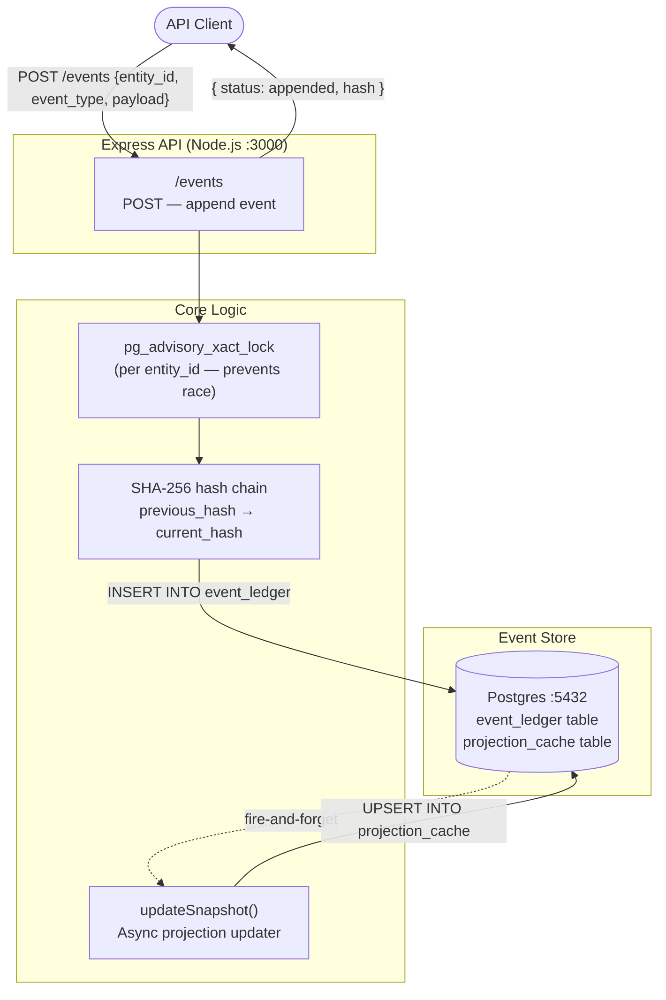
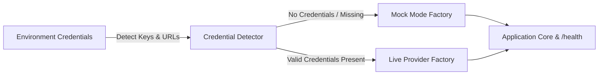
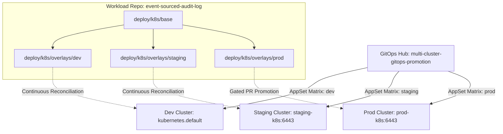

# Architecture — event-sourced-audit-log
> Last updated: 2026-08-29 | Maturity: Functional Prototype
> _Working event-sourced ledger with cryptographic hash chaining; Postgres is mocked in tests (real DB path available via shared infra compose)._

---

## System Architecture



---

## Component Table

| Component | File | Responsibility | Tech |
|---|---|---|---|
| HTTP API | `index.js` | Accepts event writes, manages transactions | Express, Node.js |
| Event ledger | `event_ledger` table | Immutable append-only log with hash chain | Postgres (real) / mocked pg (tests) |
| Projection cache | `projection_cache` table | Read-optimized current state per entity | Postgres |
| Hash chainer | `index.js:26` | Computes SHA-256 over event data + previous hash | Node.js `crypto` |
| Advisory lock | `index.js:20` | Per-entity serialization to prevent race conditions | `pg_advisory_xact_lock` |

---

## Port Assignments

| Service | Port | Notes |
|---|---|---|
| Express API | 3000 | `POST /events` endpoint |
| Postgres | 5432 | Via `docker-compose.infra.yml` or project-local compose |

---

## Data Model

```sql
-- Immutable event log (append-only)
CREATE TABLE event_ledger (
    id              SERIAL PRIMARY KEY,
    entity_id       TEXT        NOT NULL,
    event_type      TEXT        NOT NULL,      -- USER_CREATED, EMAIL_UPDATED, etc.
    payload         JSONB       NOT NULL,
    schema_version  TEXT        NOT NULL DEFAULT '1.0',
    previous_hash   TEXT        NOT NULL,      -- 'GENESIS' for first event
    hash            TEXT        NOT NULL UNIQUE,  -- SHA-256(entity_id + event_type + payload + previous_hash)
    created_at      TIMESTAMPTZ NOT NULL DEFAULT NOW()
);

-- Read-side projection (updated asynchronously)
CREATE TABLE projection_cache (
    entity_id   TEXT PRIMARY KEY,
    state       JSONB NOT NULL,
    updated_at  TIMESTAMPTZ NOT NULL DEFAULT NOW()
);
```

---

## Dependency Table

| Dependency | Status | Notes |
|---|---|---|
| `pg` (Postgres) | **Mocked in tests**, Real in production | Tests use a full `pg` mock that returns deterministic rows. Production requires Postgres 15+. |
| `express` | Real | HTTP server |
| `crypto` | Real (Node.js built-in) | SHA-256 hash chaining — no external dependency |

---

## Key Engineering Decisions

| Decision | Rationale |
|---|---|
| SHA-256 hash chaining | Each event includes the hash of the previous event, making the ledger tamper-evident — altering any event breaks all subsequent hashes |
| `pg_advisory_xact_lock` | Serializes concurrent writes per `entity_id` to guarantee monotonic hash chains without a distributed lock service |
| Async projection update | `updateSnapshot()` is fire-and-forget — write path latency is not coupled to read-model refresh |
| Mocked pg in tests | Keeps tests self-contained and fast; real Postgres path is available via `docker-compose.infra.yml` |

---

## Known Limitations / Honest Scope

- **Tests use a mocked `pg`** — the hash chaining logic is fully real; Postgres RLS and durability are not tested without the real DB
- **Single-node design** — the advisory lock pattern works per-node; distributed deployments need a different serialization mechanism
- **No authentication** — the API runs without auth; production use requires JWT/mTLS
- **No event schema evolution** — `schema_version` field exists but is not enforced with a migration strategy

## Progressive Credential Loading & Production Architecture (v0.2.0)

This service implements the **Progressive Credential Loading (PCL)** pattern, decoupling development speed from external infrastructure provisioning:



### Core Architecture Components
1. **Mode Detection Singleton:** Inspects environment configuration at boot time without hard crashes on missing secrets.
2. **Dual-Mode Factory Wrappers:**
   - **Storage / Cache:** In-process maps or SQLite `:memory:` transparently promote to managed Redis or PostgreSQL when connection strings are supplied.
   - **AI Providers:** Deterministic heuristic generators and local embeddings transparently promote to live OpenAI, Anthropic, or Gemini API clients.
3. **Hot-Reload & Dynamic TLS:** File watchers monitor mounted volume paths (Kubernetes ConfigMaps and Secrets) to update certificates and limit configs atomically without process restarts.
4. **Health & Observability:** The `/health` endpoint exposes real-time runtime mode metadata (`mock` vs `live`) across all backing adapters.

## Declarative GitOps & Multi-Cluster Deployment Architecture (v0.2.1)

This service participates in the portfolio-wide **ArgoCD Hub-and-Spoke GitOps continuous delivery catalog**:



### GitOps Topology & Separation of Concerns
1. **Base Manifests (`deploy/k8s/base`):** Declares non-root PodSecurity standards (`runAsUser: 10001`, `drop: [ALL]`, `readOnlyRootFilesystem: true`), readiness/liveness HTTP probes, and CPU/memory requests and limits without hardcoding namespace.
2. **Environment Overlays (`deploy/k8s/overlays/`):**
   - `dev/`: 1 replica, `300m/256Mi` limit, automated drift self-healing.
   - `staging/`: 2 replicas, `500m/512Mi` limit, automated drift self-healing.
   - `prod/`: 3 replicas, `1000m/1Gi` limit, gated pull-request review.
3. **ArgoCD Declarations (`deploy/argocd/`):** Houses standalone `Application` CRDs (`application.yaml`, `application-dev.yaml`, `application-prod.yaml`) and values overrides for OCI Helm and Kustomize reconciliation.
